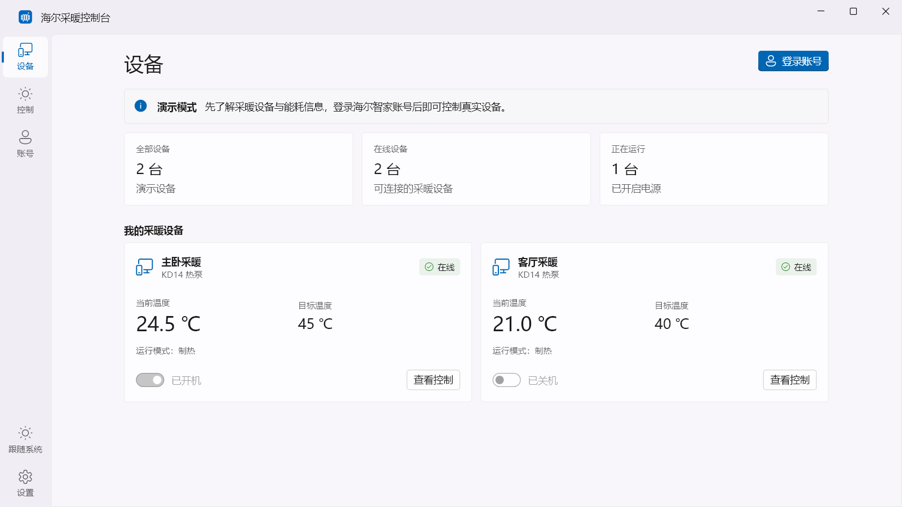
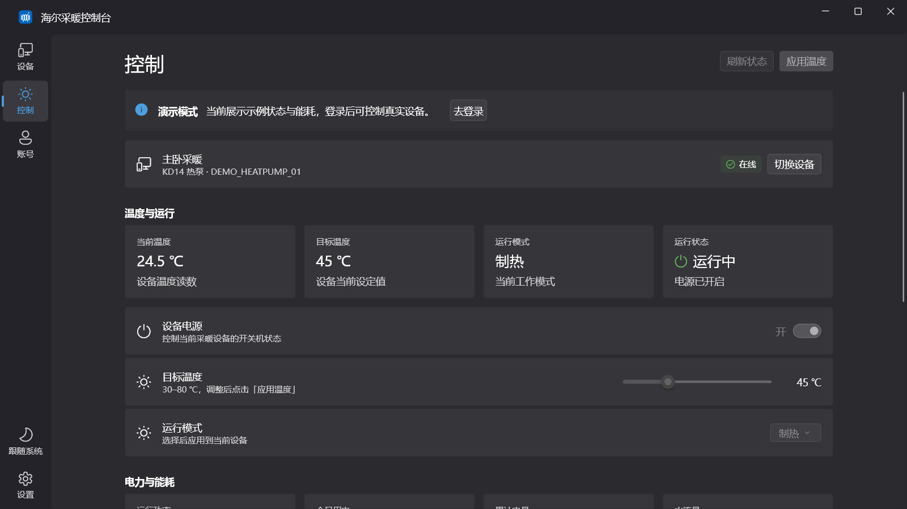

# 海尔采暖控制台

基于 **Flutter + fluent_ui** 的 Windows 桌面客户端，用于海尔智家 U+ 云热泵采暖设备的状态查看、温度调节与能耗展示。

这是个人维护的非官方客户端。当前仓库包含 Windows 工程、安装包脚本、Python 调试工具和 7 个开发 skills 的完整快照。

## 界面预览

截图由内存演示数据生成，不包含真实账号或设备标识；截图中的背景为模拟材质。

| 设备列表 · 浅色 | 控制台 · 深色 |
| --- | --- |
|  |  |

## 功能

- **设备与账号**：手机号、密码登录，设备列表、在线状态、状态快照；未登录时可浏览明确标记的演示设备。
- **采暖控制**：设备开关、目标温度、运行模式。拖动温度滑块后点击「应用温度」才发送指令。
- **能耗展示**：运行功率、累计电量、水流量、环境温度，以及根据本地采样计算的今日和近 7 天用电量。
- **Windows 桌面体验**：48 像素标题栏、窄侧栏、亮暗主题、系统强调色、启动卡片、托盘、关闭确认与开机自启动。
- **窗口材质**：Windows 11 云母与可调毛玻璃，Windows 10 使用毛玻璃；系统关闭透明效果时使用纯色背景。

真实账号登录、设备指令和能耗字段仍需连接实际设备做端到端联调。不同型号的属性与可用模式可能不同，当前代码以热泵采暖场景为主。

## 开发环境

| 项目 | 要求 |
| --- | --- |
| 平台 | Windows 10 / 11，当前仅包含 Windows runner |
| Flutter | `>= 3.47.9` |
| Dart | `^3.13.7` |
| Windows 工具链 | Visual Studio 的「使用 C++ 的桌面开发」工作负载及 Windows SDK |
| Python | 可选，仅辅助工具需要；建议 3.10+ |

依赖版本记录在 [pubspec.yaml](haier_flutter/pubspec.yaml) 和 [pubspec.lock](haier_flutter/pubspec.lock)。请保留锁文件。

## 快速运行

```powershell
git clone https://github.com/mywltd/haier-hot-control.git
cd haier-hot-control/haier_flutter
flutter doctor -v
flutter pub get --enforce-lockfile
flutter run -d windows
```

以上命令直接进入演示模式，无需账号和签名配置。演示设备不会发送控制指令，也不会写入能耗历史。

### 连接真实设备

1. 在海尔智家中准备好已有绑定设备的账号。
2. 复制配置示例，并填写自己可使用的接口签名参数：

   ```powershell
   Copy-Item config/haier.example.json config/haier.local.json
   notepad config/haier.local.json
   ```

   ```json
   {
     "HAIER_APP_ID": "MB-UZHSH-0001",
     "HAIER_APP_KEY": "填写你的接口签名 appKey"
   }
   ```

3. 携带配置启动，再在「账号」页登录：

   ```powershell
   flutter run -d windows --dart-define-from-file=config/haier.local.json
   ```

`HAIER_APP_KEY` 是接口签名参数，不是账号密码。仓库仅提供空值示例；`haier.local.json` 已被 Git 忽略。配置在编译时读取，修改后需要重新运行或构建。

Flutter 客户端的密码仅用于当次登录，令牌保留在进程内存中。Python CLI 会另外保存本地会话文件。

## 验证与构建

在 `haier_flutter/` 下执行：

```powershell
flutter analyze
flutter test --reporter expanded
flutter build windows --release
```

上述构建可运行演示模式。需要真实设备登录时使用本地配置构建：

```powershell
flutter build windows --release --dart-define-from-file=config/haier.local.json
```

输出程序位于 `build/windows/x64/runner/Release/haier_heat.exe`。分发时需要保留整个 `Release` 目录，包括 DLL 和 `data/`。编译参数会进入构建产物，因此带个人配置的产物仅供自行使用。

### 安装包

`windows/packaging/` 提供 Inno Setup 6 构建脚本。在 `haier_flutter/` 下可生成不带签名配置的演示安装包，Inno Setup 路径请按本机位置调整：

```powershell
powershell -NoProfile -ExecutionPolicy Bypass -File windows/packaging/build.ps1 -FlutterPath (Get-Command flutter).Source -InnoSetupPath 'C:\Program Files (x86)\Inno Setup 6\ISCC.exe' -Demo
```

脚本输出到 `dist/`，程序和校验文件均不提交。自行使用真实设备时可去掉 `-Demo`，默认读取 `config/haier.local.json`，也可用 `-DartDefineFile` 指定本地配置。本次源码上传未验证安装、升级和卸载流程。

### 界面截图

界面截图检查：

```powershell
flutter test tool/capture_ui_test.dart --reporter expanded
```

该检查使用 Windows 系统字体、内存数据和模拟背景，生成 `artifacts/ui/` 下的亮暗主题、多种尺寸截图。真实云母、失焦和托盘恢复的检查方法见 [开发说明](docs/development.md)。

## 仓库结构

```text
haier-hot-control/
├── haier_flutter/              Flutter Windows 应用
│   ├── config/                 签名配置示例；本地配置不提交
│   ├── lib/haier/              云接口、会话状态、能耗采样
│   ├── lib/pages/              设备、控制、账号、设置页面
│   ├── lib/app/                主题、窗口材质、托盘与启动
│   ├── lib/shell/              标题栏、侧栏与切页
│   ├── test/                   业务状态与界面测试
│   ├── tool/                   截图、窗口探针、图标生成工具
│   └── windows/                Windows runner
├── python工具/                 CLI 与 mitmproxy 调试插件
├── skills/                     7 个 skills，含模板和参考资料
└── docs/                       开发说明和脱敏后的界面预览
```

## Skills

完整清单和使用方式见 [skills/README.md](skills/README.md)。

| Skill | 用途 |
| --- | --- |
| `fluent-desktop-design` | Windows 11 Fluent 设计规范、组件与常见问题 |
| `fluent-desktop-shell` | Flutter Windows 外壳、主题、窗口与托盘模板 |
| `flutter-ui-screenshots` | Widget 截图与独立原生窗口探针 |
| `flutter-windows-installer` | Inno Setup 安装包模板 |
| `flutter-rust-bridge` | Flutter 与 Rust 集成参考 |
| `shadcn-flutter` | shadcn Flutter 组件资料 |
| `find-skills` | Skill 查找与安装说明 |

其中 Rust 桥接和 shadcn skill 为备用资料；当前应用使用 `fluent_ui`，没有接入 Rust。安装包脚本位于 `haier_flutter/windows/packaging/`，仓库不包含编译后的安装包。

## Python 辅助工具

工具说明见 [python工具/README.md](python工具/README.md)。CLI 支持登录、设备查询、属性查看和控制；抓包插件用于本地接口调试。会话、抓包记录和能耗数据已加入忽略规则。

## 已知限制

- 自动化测试使用模拟接口，不证明真实云端登录和设备控制已经联调通过。
- 能耗历史来自手动刷新和控制后的采样，不是云端账单；当前采样历史未按设备或账号分开。
- 尚未实现常驻 WebSocket 状态订阅与后台定时采样。
- Windows 10 的兼容分支有模拟截图覆盖，仍需 Windows 10 实机验证。

接口代码保留了对 [xxxifan/haier_win11_widgets](https://github.com/xxxifan/haier_win11_widgets) 和 [banto6/haier](https://github.com/banto6/haier) 的参考标注。详细协议、维护入口和待办见 [开发说明](docs/development.md)。
